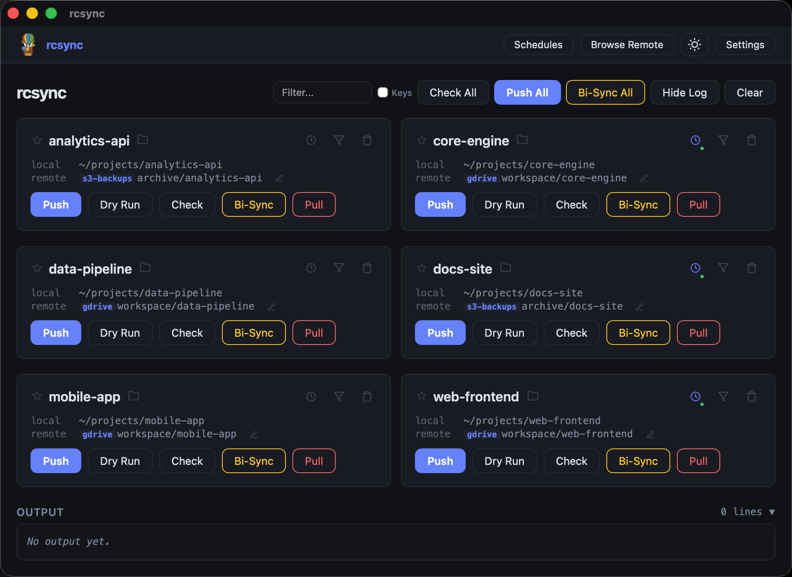

<p align="center">
  
</p>

<h1 align="center">rcsync</h1>

<p align="center">
  A keyboard-driven desktop app for syncing local project folders with cloud storage through <a href="https://rclone.org">rclone</a>.
</p>

<p align="center">
  
</p>

rcsync finds project folders on your computer, shows which ones have changed, and pushes them to Google Drive, OneDrive or any other rclone remote. It runs the rclone command for each action, so rclone must be installed and your remotes configured before you start. It is built with [Tauri v2](https://tauri.app) and [Svelte 5](https://svelte.dev).

Local files are authoritative. Push runs without confirmation and makes the remote match your local folder, including deleting remote files that no longer exist locally. Pull, Bi-Sync and Delete each ask you to type a confirmation word (`pull`, `bisync`, `delete`), and Delete removes only the local copy.

The latest release has Windows x64 installers. On macOS, build from source; the last macOS download (v0.2.0) is for Apple silicon only and predates scheduled Push. Linux can be built from source but has no release. Release builds are unsigned, so Windows SmartScreen and macOS Gatekeeper warn on first launch.

## Features

- Push, Pull, Bi-Sync, Check (compare without changing anything) and Dry Run (preview a Push) for each project, plus Check All, Push All and Bi-Sync All.
- Finds projects by scanning local folders, and marks a project as modified when its files change.
- Switches between several rclone remotes.
- Pins projects to the top of the dashboard.
- Pushes a project on a schedule (every few hours or days, or at a set time on chosen weekdays) while the app is open.
- Shares project definitions between devices through a synced config file, while schedules stay on each device.

## Setup

1. Install rclone, for example `brew install rclone` on macOS or `scoop install rclone` on Windows, or download it from [rclone.org](https://rclone.org/downloads/).
2. Configure your remotes with `rclone config` (rcsync does not handle sign-in), then confirm they work:

   ```bash
   rclone listremotes
   rclone lsd gdrive:
   ```

3. Keep each project as a folder under one base path on the remote, such as `gdrive:proj/my-webapp`.

To build rcsync you need Node.js 18 or newer with npm, stable Rust, and the [Tauri prerequisites](https://v2.tauri.app/start/prerequisites/) for your platform.

```bash
git clone https://github.com/smkwray/rcsync.git
cd rcsync
npm ci
npm run tauri build    # the app is written to src-tauri/target/release/bundle/
```

Use `npm run tauri dev` to run it in development mode.

## Configuration

rcsync reads `rcsync-config.json` from the folder that contains the app (set `RCSYNC_CONFIG` to use another path). It holds your remotes, scan folders, extra excludes and projects, and you can sync it between devices with Syncthing or similar. Each project has a stable `id`; keep it when you rename a project.

```json
{
  "rclone_path": "rclone",
  "remote": "gdrive",
  "remotes": [
    { "name": "gdrive", "base_path": "proj" },
    { "name": "onedrive", "base_path": "Projects" }
  ],
  "extra_excludes": ["dist/**", "*.log"],
  "scan_dirs": ["~/projects", "~/code"],
  "projects": [],
  "auto_check_on_launch": false
}
```

| Setting | Description |
|---|---|
| `remote` | Active remote |
| `remotes` | Available remotes and their base paths |
| `scan_dirs` | Local folders to scan for projects |
| `extra_excludes` | Your exclude patterns, added to the defaults |
| `auto_check_on_launch` | Run Check All when the app opens |
| `rclone_transfers` | Files transferred in parallel per rclone process, 1 to 8; omit it to use rclone's default |

Every operation applies the default excludes from `src-tauri/defaults.json` (caches, virtual environments, build output, `.git` and OS metadata files) and your `extra_excludes`. The defaults cannot be removed in the app; a `defaults.json` next to the app, or the file named by `RCSYNC_DEFAULTS`, replaces the built-in copy.

Schedules are stored only on the device that runs them, in `local-config-<device-id>.json` under `~/Library/Application Support/rcsync` on macOS or `%LOCALAPPDATA%\rcsync` on Windows, so syncing `rcsync-config.json` does not start the same Push on another device. Press `t` on a project, or use its clock icon, to set one. If rcsync was closed when a Push was due, it runs one Push on the next launch. A failed scheduled Push is retried once an hour later. By default, scheduled Pushes run one at a time.

When you delete a project's local copy in rcsync, it marks its remote folder as retired, and Push and Bi-Sync stay blocked for that folder on every device that shares the config until you reattach it in the app.

## Safety limits

- Push refuses to run when rclone reports the local folder as empty, because syncing an empty folder would delete the remote copy. Do not change a project while it is being pushed: the empty check and the sync are separate rclone runs.
- rclone remotes that override sync or filter options with `global.*` settings in the rclone config are not supported, because the empty check would not see those overrides.
- rcsync stops a Push, Pull or Dry Run that shows no progress for 30 minutes, or reports none in its first 10 minutes, and marks it as failed. A stopped Push is retried once; a stopped Pull is not. Bi-Sync and Check are never stopped automatically, but you can cancel them.
- Each run's rclone log is kept under `rcsync/run-logs/` in your user config folder (the newest 20 per project). These logs include local file paths.

## Keyboard shortcuts

Press `?` for this list in the app. **Cmd+K** or the **Keys** checkbox turns the single-key shortcuts on or off.

| Key | Action |
|---|---|
| `j` `k` `l` `;` | Move down, up, left, right |
| `/` | Focus the filter |
| `a` `s` `d` `f` `g` | Push, Dry Run, Check, Bi-Sync, Pull the selected project |
| `h` | Delete the selected project's local copy |
| `e` `i` `t` `q` | Open folder, pin, schedule, cancel for the selected project |
| `c` `p` `v` | Check All, Push All, Bi-Sync All |
| `b` `m` | Browse remote, schedule manager |
| `o` `x` | Toggle, clear the output log |
| `Esc` | Deselect or close |
| `Cmd+,` `Cmd+.` `Cmd+O` | Settings, cancel all operations, toggle output (always on) |

## How it works

| Action | rclone command |
|---|---|
| Push | `rclone sync <local> <remote>` |
| Pull | `rclone sync <remote> <local>` |
| Bi-Sync | `rclone bisync <local> <remote>` |
| Check | `rclone check --combined` |
| Dry Run | `rclone sync --dry-run` |

## License

MIT. See [LICENSE](LICENSE).
